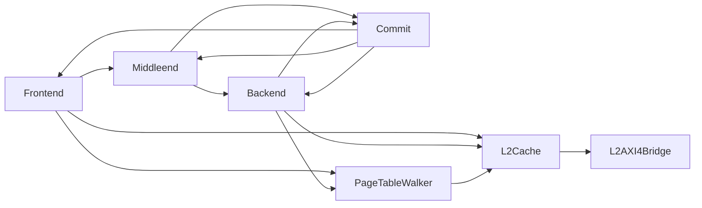

# 处理器顶层

`ZirconCore` 是处理器集成顶层，例化 `Frontend`、`Middleend`、`Backend`、
`Commit`、`L2Cache` 和 `L2AXI4Bridge`，系统配置还包含 `PageTableWalker`。顶层负责连接模块接口、
中断输入、地址翻译控制和 AXI 主接口，不在顶层实现指令执行或缓存状态机。

## 静态配置

`system` 配置提供 RV32IMAF、M/S/U 特权状态、Sv32 地址翻译和 Linux 运行环境。
`performance` 配置提供 RV32IMF、Zicsr、Zicntr 与 Zve32f，VLEN 为 256 bit、ELEN 为
32 bit。它使用直接物理寻址，面向裸机整数和 FP32 数组计算。

两种配置复用前端、三宽标量重命名与派发、ROB、标量执行和 Cache 模块。
性能配置增加独立 SIMD8 后端，在 RTL 展开时裁剪特权 CSR、TLB/PTW、中断与原子单元。
向量重命名和寄存器堆分别复用参数化的 `Rename` 与 `Regfile`，完整设计见
[SIMD8 性能核心](PerformanceCore.md)。

## 外部接口

系统配置通过一个 64 位数据宽度的 AXI4 主接口访问外部存储器；64 B cache line 事务分为 8 个
8 字节 beat 传输，PMA 可合并写窗口中的连续 Store 也通过同一接口形成最长 8 beat 的 INCR
burst。中断输入包括机器软件中断、机器定时器中断、
机器外部中断和监管态外部中断。仿真版本额外导出三路退休信息、ROB 头状态和性能计数器；
综合版本不例化这些观测逻辑。

性能配置的 AXI4 数据宽度为 256 bit，一条 Cache Line 使用两个 beat 传输；设备访问保留
原始访问尺寸和字节 strobe。该配置没有中断输入，仿真接口增加向量退休、配置和目的寄存器观测。

## 控制连接

系统配置的 `Commit` 保存当前特权级和 CSR 状态。顶层从 `satp`、当前特权级、`mstatus.MXR` 与
`mstatus.SUM` 生成统一的 `AddressTranslationControl`，送入 ITLB、DTLB 和 PTW。
`SFENCE.VMA` 触发 TLB 与 PTW 清空；`FENCE.I` 等待存储系统排空后请求 DCache 写回和
ICache 失效。

分支恢复和异常恢复由 `Commit` 广播到前端、中端和后端。前端使用恢复 PC 重新取指，
中端恢复映射状态，后端清除年轻指令和推测唤醒状态。

性能配置保留分支恢复与基础 `FENCE`。向量指令携带配置快照，完成后在 ROB 按序退休，
退休更新向量映射、配置和运算标志。`PerformanceCSR` 提供浮点、向量和非特权计数器状态；
`time` 与 `cycle` 使用核心时钟作为时基。
